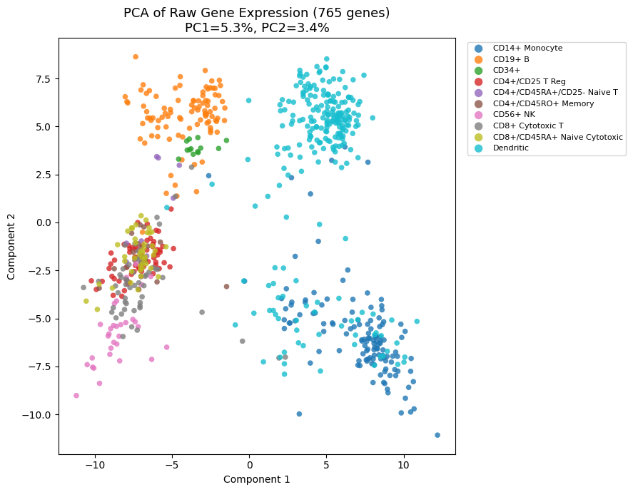
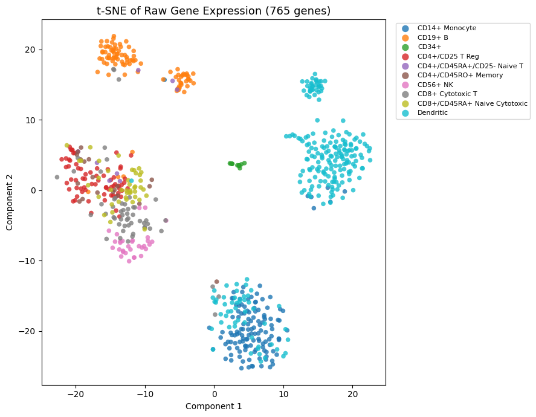
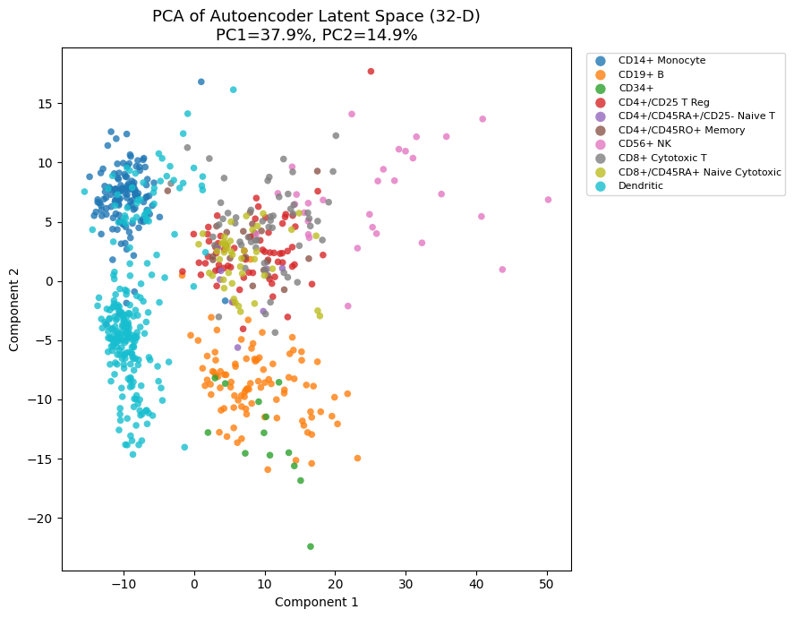
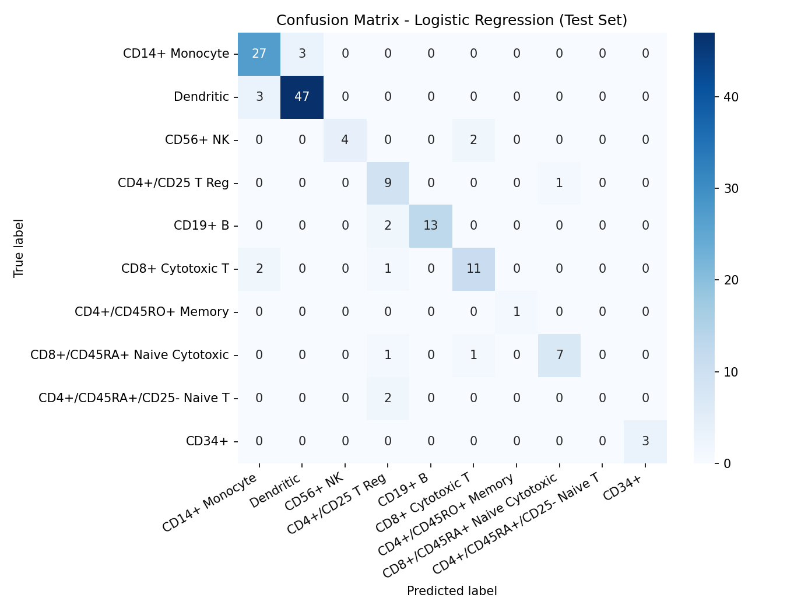
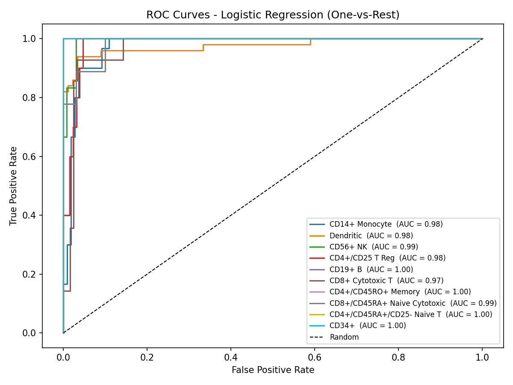
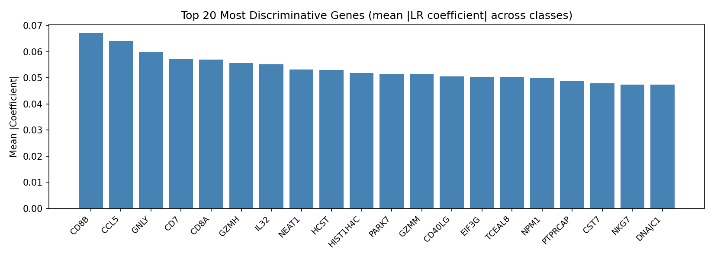
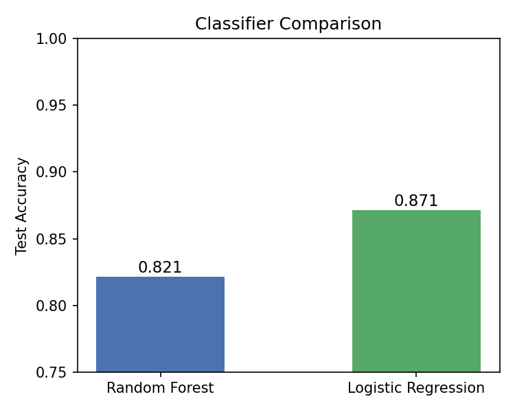

# PBMC Cell-Type Classification from Single-Cell RNA-seq

Dimensionality reduction and supervised classification of 700 peripheral blood mononuclear cells (PBMCs) into 10 immune cell types, using a PyTorch autoencoder, PCA, t-SNE, logistic regression, and random forests.


## Overview

Single-cell RNA-seq measures the expression of thousands of genes in each individual cell. The data is high-dimensional and noisy, which makes it hard to visualize and hard to classify directly. This project works with **700 cells × 765 genes** labeled with **10 cell types** and answers two questions:

1. **Representation learning:** how well do PCA, t-SNE, and a learned autoencoder latent space separate cell types in two dimensions?
2. **Classification:** how accurately can a model predict a cell's type from its gene expression, and which genes drive the predictions?

## Results

| Metric | Value |
|---|---|
| Autoencoder held-out reconstruction MSE (32-D latent, 80/20 split) | **0.902** (train 0.735) |
| Logistic regression, test accuracy | **87.1%** (122 / 140 cells) |
| Random forest baseline, test accuracy | 82.1% |
| Logistic regression, 5-fold stratified CV accuracy (training set) | 81.1% ± 3.3% |
| Test macro-avg F1 / weighted-avg F1 | 0.79 / 0.87 |
| One-vs-rest ROC AUC, range across 10 classes | 0.97 – 1.00 |

The most influential genes, by mean absolute logistic regression coefficient, are **CD8B, CCL5, GNLY, CD7, and CD8A**. These are established cytotoxic T-cell and NK-cell markers, which suggests the model is learning real biology rather than noise.

### Part 1: Dimensionality reduction

| PCA (raw genes) | t-SNE (raw genes) | PCA (autoencoder latent space) |
|:---:|:---:|:---:|
|  |  |  |

- **t-SNE** separated the ten populations most clearly: B cells, CD34+ progenitors, dendritic cells, and monocytes form distinct islands, and some related T-cell populations partially separate.
- **Raw PCA** is linear and its first two components explain only 8.7% of variance, so T-cell subtypes overlap heavily.
- **Autoencoder latent PCA** gives a more structured space, with two components explaining 52.8% of the *latent* variance. The percentages for raw and latent PCA are computed over different spaces (765-D vs. 32-D), so they show how compact each representation is, not which one separates cell types better. Because the last step is still linear, it resolves non-linear cluster boundaries less well than t-SNE.

### Part 2: Classification

| Confusion matrix (test set) | ROC curves (one-vs-rest) |
|:---:|:---:|
|  |  |

| Top 20 genes | Logistic regression vs. random forest |
|:---:|:---:|
|  |  |

<details>
<summary><b>Per-class test performance</b></summary>

| Cell type | Precision | Recall | F1 | Test cells |
|---|---|---|---|---|
| CD14+ Monocyte | 0.84 | 0.90 | 0.87 | 30 |
| Dendritic | 0.94 | 0.94 | 0.94 | 50 |
| CD56+ NK | 1.00 | 0.67 | 0.80 | 6 |
| CD4+/CD25 T Reg | 0.60 | 0.90 | 0.72 | 10 |
| CD19+ B | 1.00 | 0.87 | 0.93 | 15 |
| CD8+ Cytotoxic T | 0.79 | 0.79 | 0.79 | 14 |
| CD4+/CD45RO+ Memory | 1.00 | 1.00 | 1.00 | 1 |
| CD8+/CD45RA+ Naive Cytotoxic | 0.88 | 0.78 | 0.82 | 9 |
| CD4+/CD45RA+/CD25- Naive T | 0.00 | 0.00 | 0.00 | 2 |
| CD34+ | 1.00 | 1.00 | 1.00 | 3 |

</details>

### Limitations

- **Class imbalance and tiny test classes.** Dendritic cells (240) and CD14+ monocytes (129) dominate, while CD4+/CD45RA+/CD25- Naive T has only 8 cells in total. The model got 0 of 2 held-out cells of that class correct, yet its one-vs-rest AUC is 1.00. AUC computed on two positive examples is not reliable, so per-class metrics for rare types should be read cautiously.
- **Generalization gap.** Training accuracy is 100%, versus 87.1% on the test split and 81.1% cross-validated. The 140-cell test split is small, which is why the cross-validated figure is reported alongside it.
- **Similar T-cell subtypes** (regulatory, naive, memory, cytotoxic) account for most errors, consistent with their overlap in the embeddings.
- **Possible extensions:** stratified train/test splitting, class weighting or resampling, hyperparameter search over the regularization strength `C`, and classifying directly on the autoencoder latent space.

## Methods

**Autoencoder** (`notebooks/01_autoencoder_dimensionality_reduction.ipynb`)

- Architecture: `765 → 128 → 64 → 32 → 64 → 128 → 765`, ReLU activations, with a standalone `Encoder` module for extracting latent codes.
- Loss: MSE reconstruction plus an L1 sparsity penalty on the latent code (λ = 1e-5).
- Training: Adam, learning rate 1e-4, batch size 64, 200 epochs, seed 42.
- Model selection: trained on an 80/20 split and watched held-out MSE plateau near 0.90 without rising, then retrained with identical settings on all 700 cells to produce the final embedding. The autoencoder is unsupervised, so labels are never used in training.
- Embeddings: PCA on raw genes; t-SNE (perplexity 30) on the top 50 principal components of raw genes; PCA on the 32-D latent codes.

**Classifier** (`notebooks/02_cell_type_classification.ipynb`)

- Labels are one-hot encoded, shuffled together with the features (seed 100), and split 80/20 into 560 training and 140 test cells.
- Features are standardized with `StandardScaler`, fit on the training set only.
- Primary model: multinomial logistic regression, L2 penalty (C = 1.0), `lbfgs` solver. It was chosen for strong performance on normalized continuous features, calibrated class probabilities (needed for per-class ROC curves), and coefficients that map directly back to genes.
- Baseline: random forest, 200 trees, on unscaled features.
- Evaluation: classification report, confusion matrix, one-vs-rest ROC/AUC, 5-fold stratified cross-validation, and coefficient analysis.

## Repository structure

```
pbmc-cell-type-classification/
├── README.md
├── LICENSE
├── requirements.txt
├── data/
│   ├── processed_counts.csv   # 700 cells x 765 genes, normalized log counts
│   └── labels.csv             # cell barcode -> cell-type label
├── notebooks/
│   ├── 01_autoencoder_dimensionality_reduction.ipynb
│   └── 02_cell_type_classification.ipynb
├── figures/                   # all figures shown above
```

## Getting started

```bash
git clone https://github.com/YOUR-USERNAME/pbmc-cell-type-classification.git
cd pbmc-cell-type-classification

python -m venv .venv
source .venv/bin/activate          # Windows: .venv\Scripts\activate
pip install -r requirements.txt

cd notebooks
jupyter notebook
```

Run the notebooks from the `notebooks/` directory, since they read from `../data/` and write to `../figures/`. Notebook 01 needs PyTorch; notebook 02 needs only scikit-learn. Both run on CPU in a few minutes. Seeds are fixed (42 for the autoencoder and t-SNE, 100 for the classifier split) for reproducibility.

## Data

- `processed_counts.csv`: rows are cells (10x barcodes), columns are 765 genes, values are normalized log-transformed counts, already cleaned and provided with the course assignment.
- `labels.csv`: cell-type labels assigned by the original researchers (`bulk_labels`).
- The data used is the 700-cell PBMC subset distributed with Scanpy as `pbmc68k_reduced`, derived from the 10x Genomics 68k PBMC dataset (Zheng et al., *Nature Communications*, 2017). Please credit the original source if you reuse it. The MIT license in this repo covers the code only, not the data.

| Cell type | Cells |
|---|---|
| Dendritic | 240 |
| CD14+ Monocyte | 129 |
| CD19+ B | 95 |
| CD4+/CD25 T Reg | 68 |
| CD8+ Cytotoxic T | 54 |
| CD8+/CD45RA+ Naive Cytotoxic | 43 |
| CD56+ NK | 31 |
| CD4+/CD45RO+ Memory | 19 |
| CD34+ | 13 |
| CD4+/CD45RA+/CD25- Naive T | 8 |

## Tech stack

Python · PyTorch · scikit-learn · pandas · NumPy · matplotlib · seaborn · Jupyter

## Author

**Viraj Gupta** · [LinkedIn](https://www.linkedin.com/in/viraj-roy-gutpa) · [virajgupta@berkeley.edu](mailto:virajgupta@berkeley.edu)
